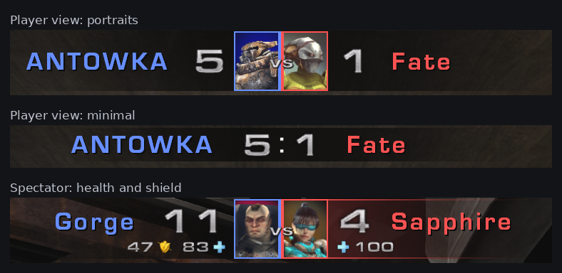

# UTDuel

A 1 on 1 duel game type for **Unreal Tournament 2004**.



[Русская версия](README.ru.md) · [Changelog](CHANGELOG.md) · [Download the latest release](https://github.com/F-51/UTduel/releases/latest)

## What it is

A duel mode with its own score panel at the top of the screen: nicks and score. Spectators also see the health and shield of both players.

The panel comes in two styles: with player portraits (the default) and a minimalist one, if you are a hardcore esports player and don't care who you are playing against.

Also:

- **Duel queue.** Spectators queue for the duel. A player who joins a full server becomes a spectator in the queue instead of seeing "server is full". The loser of a match goes to the end of the queue.
- **Next match without reloading.** After the score screen the next match starts on the same map, with an announcer countdown.
- **Pauses.** A player can pause the match (the Pause key, `DuelPause` or `!pause` in the chat); an admin can pause at any time.
- **Connection loss.** If a duelist's game drops during the match, the match is paused and his slot is kept. He comes back with his score, health, shield, weapons with ammo and his place. If he is not back in time, he forfeits.
- **Spectator tools.** The panel is lit behind the watched player, a new spectator starts on a duelist in first person, the HUD takes the colour of the watched side.
- **UTComp friendly.** UTComp coloured nicks and model colours on the panel, its crosshair settings, its warm-up and votes are respected.
- **The challenger picks the map** (a server setting, off by default). Everyone in the queue picks the map of his next duel; the winner who stays has no say.
- **Your language.** The menus, the HUD and the messages of the server come in the language of each player's own game. English and Russian included; a translation is one text file (see `readme_en.txt`, TRANSLATION).
- **A quiet screen.** The chat of spectators and players can be hidden from the screen (ESC → Duel HUD); it stays in the chat window (F2) and the console.
- **Fair play.** The health and shield of the players are sent to spectators only. Players never receive them.

## Installation

Copy into the `System` folder of the server (and of the players, if they like):

```
UTDuel_v124.u   UTDuel_v124.int   UTDuel_v124.ucl   UTDuel_v124.rut
```

For a redirect server the compressed package is in the `Redirect` folder of the archive: `UTDuel_v124.u.uz2`.

In the server's `UT2004.ini`, section `[Engine.GameEngine]`:

```
ServerPackages=UTDuel_v124
```

Remove the line of an older version (for example `ServerPackages=UTDuel_v123`).

Game type: `UTDuel_v124.DuelGame` (listed as "Duel"). Example:

```
ucc server DM-Rankin?game=UTDuel_v124.DuelGame
```

The `.ucl` file is needed by WebAdmin and the game menus: without it the game type is not listed. At its first start the server writes the settings of the mode to its ini, section `[UTDuel_v124.DuelGame]`.

## Server settings

In the game rules (Rules tab), in WebAdmin and in the server's ini. A logged-in admin also has the queue and pause settings in ESC → Duel Settings.

| Setting | Default | |
|---|---|---|
| Double Damage | off | its pickups are removed from the map |
| List as Deathmatch | on | the server shows up in the Deathmatch list of the server browser |
| End Match When a Player Leaves | on | a duelist who leaves or goes to spectate during the match loses it at once |
| Restart Map After Match | on | the next match on the same map without reloading |
| Queue System | on | the duel queue |
| Challenger Picks the Map | off | everyone in the queue picks the map of his next duel (ESC → Pick Map); needs the Queue System and Restart Map After Match |
| Pause System | on | the switch of all the pauses |
| Pause on Connection Loss | on | the technical pause |
| Connection Loss Pause Time | 120 | seconds, 10..600 |
| Player Pause Time (0 = off) | 60 | seconds, 0..600 |
| Pauses a Player Has per Match | 1 | 0..10 |

## Main console commands

| Command | |
|---|---|
| `DuelHelp`, `DuelHelpAll` | the main commands / all commands |
| `DuelMenu` | the Duel HUD window (also ESC → Duel HUD) |
| `DuelPortraits [1\|0]` | player portraits on the panel |
| `DuelHP [...]` | spectator: the layout of health and shield on the panel |
| `DuelStyle [name]` | apply a panel preset |
| `DuelPause` | ask for a pause / end yours |
| `DuelReset` | all HUD settings back to the defaults |
| `mutate duelqueue` | show the queue (admin: `on`, `off`, `clear`) |

The full reference (every command and panel setting) is in `readme_en.txt` / `readme_ru.txt` inside the release archive.

## License

Free to use and distribute. No warranty.
