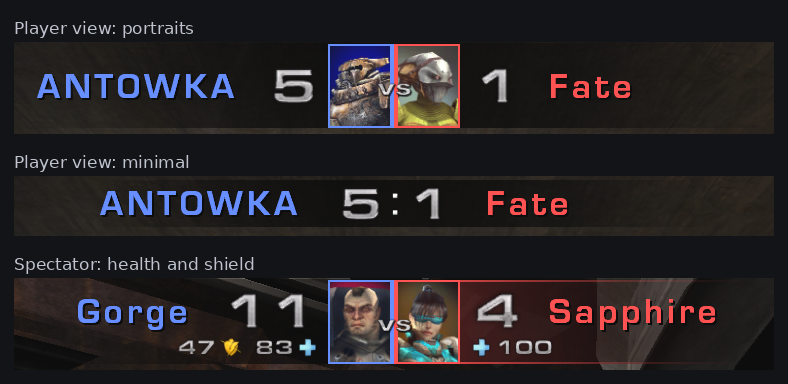

# UTDuel

Режим дуэли 1 на 1 для **Unreal Tournament 2004**.



[English version](README.md) · [История изменений](CHANGELOG.md) · [Скачать последний релиз](https://github.com/F-51/UTduel/releases/latest)

## Что это

Режим дуэли со своей панелью счёта вверху экрана: ники и счёт. Зритель дополнительно видит здоровье и щит обоих.

Панель выполнена в двух стилях: с портретами игроков (по умолчанию) и минималистичная — если вы жёсткий киберспортсмен и вам пофигу, кто против вас.

А ещё:

- **Очередь на дуэль.** Зрители встают в очередь. Зашедший на полный сервер становится зрителем в очереди вместо «сервер полон». Проигравший уходит в конец очереди.
- **Следующий матч без перезагрузки.** После экрана статистики следующий матч начинается на той же карте, с отсчётом аннонсера.
- **Паузы.** Игрок может поставить паузу (клавиша Pause, `DuelPause` или `!pause` в чате); админ — когда угодно.
- **Вылеты.** Если игра дуэлянта отвалилась посреди матча, матч встаёт на паузу, а его слот держится. Он возвращается на своё место со своим счётом, здоровьем, щитом, оружием и патронами. Не вернулся вовремя — поражение.
- **Для зрителя.** Подсветка панели за наблюдаемым игроком, новый зритель сразу смотрит на дуэлянта от первого лица, HUD в цвете наблюдаемой стороны.
- **Дружит с UTComp.** Цветные ники и цвета моделей UTComp на панели, его настройки прицела, разминка и голосования.
- **Претендент выбирает карту** (настройка сервера, по умолчанию включена). Каждый в очереди выбирает карту своей следующей дуэли; остающийся победитель в выборе не участвует.
- **На вашем языке.** Меню, HUD и сообщения сервера — на языке игры каждого игрока. Пока английский и русский, другие языки будут добавляться с обновлениями мода (перевод — один текстовый файл, см. `readme_ru.txt`, ЛОКАЛИЗАЦИЯ).
- **Без лишнего на экране.** Чат зрителей и игроков можно убрать с экрана (ESC → Duel HUD): он остаётся в окне чата (F2) и в консоли.
- **Честная игра.** Здоровье и щит игроков сервер отправляет только зрителям. Игроки их не получают.

## Установка

Скопировать в папку `System` сервера (а при желании и игроков):

```
UTDuel_v125.u   UTDuel_v125.int   UTDuel_v125.ucl   UTDuel_v125.rut
```

Для redirect-сервера сжатый пакет лежит в папке `Redirect` архива: `UTDuel_v125.u.uz2`.

В `UT2004.ini` сервера, в секции `[Engine.GameEngine]`:

```
ServerPackages=UTDuel_v125
```

Строку старой версии (например `ServerPackages=UTDuel_v124`) убрать.

Тип игры: `UTDuel_v125.DuelGame` (в списках — «Duel»). Пример:

```
ucc server DM-Rankin?game=UTDuel_v125.DuelGame
```

Файл `.ucl` нужен вебадминке и меню игры: без него режим не появится в списках. При первом запуске сервер записывает настройки режима в свой ini, секция `[UTDuel_v125.DuelGame]`.

## Настройки сервера

В правилах игры (вкладка Rules), в WebAdmin и в ini сервера. Залогиненному админу настройки очереди и пауз доступны ещё и в ESC → Duel Settings.

| Настройка | По умолчанию | |
|---|---|---|
| Double Damage | выкл | его бонусы убираются с карты |
| Adrenaline | выкл | таблетки адреналина и комбо |
| Grenades on Spawn | 1 | гранат у штурмовой винтовки после спавна, 0..8; если работает UTComp, решает он |
| List as Deathmatch | вкл | сервер виден в списке Deathmatch браузера серверов |
| End Match When a Player Leaves | вкл | дуэлянт, вышедший или ушедший в зрители посреди матча, сразу проигрывает |
| Restart Map After Match | вкл | следующий матч на той же карте без перезагрузки |
| Queue System | вкл | очередь на дуэль |
| Challenger Picks the Map | вкл | каждый в очереди выбирает карту своей следующей дуэли (ESC → Pick Map); нужна Queue System; без Restart Map After Match выбор важнее ротации карт и голосования в конце матча |
| Pause System | вкл | общий выключатель всех пауз |
| Pause on Connection Loss | вкл | пауза при вылете |
| Connection Loss Pause Time | 120 | секунд, 10..600 |
| Player Pause Time (0 = off) | 60 | секунд, 0..600 |
| Pauses a Player Has per Match | 1 | 0..10 |

## Основные команды консоли

| Команда | |
|---|---|
| `DuelHelp`, `DuelHelpAll` | основные / все команды |
| `DuelMenu` | окно Duel HUD (оно же ESC → Duel HUD) |
| `DuelPortraits [1\|0]` | портреты игроков на панели |
| `DuelHP [...]` | зритель: раскладка здоровья и щита на панели |
| `DuelStyle [имя]` | применить пресет панели |
| `DuelPause` | попросить паузу / снять свою |
| `DuelReset` | все настройки HUD по умолчанию |
| `mutate duelqueue` | показать очередь (админ: `on`, `off`, `clear`) |

Полный справочник (все команды и настройки панели) — в `readme_ru.txt` / `readme_en.txt` внутри архива релиза.

## Лицензия

Можно свободно использовать, изменять и распространять. Без гарантий.
